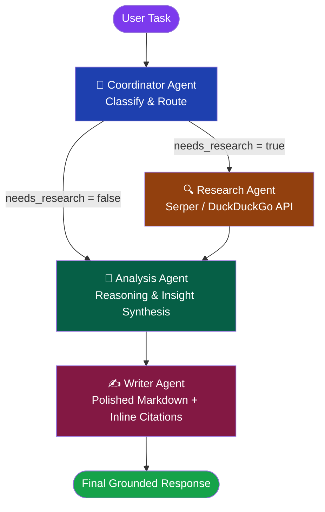

# 🤖 AI Multi-Agent Research and Analysis System

[](https://multi-agent-ai-system-zgincdwrxp7vsdwe9fcrkc.streamlit.app/)
[](https://github.com/RedamJaswanth/Multi-Agent-AI-System)

A production-style multi-agent AI system built with **LangGraph & Microsoft AutoGen**, **Google Gemini 2.5 Flash**, **Serper Google Search API**, **DuckDuckGo**, and **Streamlit**. The system intelligently routes user tasks through a pipeline of specialised agents — only invoking web research when genuinely required, with quota safeguards and session limits.

---

### 🌐 Live Demo
👉 **[Open Live App on Streamlit Community Cloud](https://multi-agent-ai-system-zgincdwrxp7vsdwe9fcrkc.streamlit.app/)**

---

### 📸 Application Interface

```
+-----------------------------------------------------------------------------------------+
|  🤖 Agent Status             |  🤖 AI Multi-Agent Research and Analysis System          |
|  --------------------------- |  ------------------------------------------------------- |
|  🧭 Coordinator Agent: Done  |  📝 Enter your task or question:                         |
|  🔍 Research Agent: Done     |  [ What are the latest developments in quantum computing?]|
|  🧠 Analysis Agent: Done     |                                                          |
|  ✍️ Writer Agent: Done       |  [🚀 Run Analysis]                                       |
|                              |                                                          |
|  ⚙️ Service Status          |  📄 Final Response                                       |
|  - Gemini LLM: Active        |  ======================================================= |
|  - Search: Serper API        |  Recent 2025 breakthroughs in fault-tolerant quantum...  |
|  - Turns: 1 / 10             |  🔗 Sources: [1] nature.com [2] arxiv.org                |
+-----------------------------------------------------------------------------------------+
```
*(Screenshot placeholder: place screenshot at `assets/screenshot.png`)*

---

### ✨ Key Features

- **Autonomous Agent Routing** — The Coordinator Agent classifies each incoming task and decides whether web research is required.
- **Dual Web Search Providers** — High-speed Google search via **Serper API** with seamless fallback to **DuckDuckGo**.
- **Four Distinct Roles** — Specialized Coordinator, Research, Analysis, and Writer agents maintain single responsibilities.
- **Quota & Turn Rate-Limiting** — Capped at 10 conversational turns per session with automatic rate-limit and quota error recovery.
- **Streamed Real-Time UI** — Interactive agent status cards pulse and update dynamically as each agent finishes execution.
- **Memory Retention** — Retains conversation history across turns for contextual follow-up questions.

---

### 🏗️ Architecture



---

### 🤖 Agent Responsibilities

| Agent | Role | Key Actions |
|-------|------|-------------|
| **Coordinator** | Router & Classifier | Classifies task (`ANALYSIS`, `RESEARCH`, `RESEARCH_AND_ANALYSIS`) and triggers research only when needed |
| **Research** | Web Intelligence | Executes Serper Google search or DuckDuckGo, filters low-quality links, summarises evidence |
| **Analysis** | Deep Reasoning | Synthesizes insights, separates confirmed facts from hypotheses, highlights patterns |
| **Writer** | Polished Composer | Writes structured Markdown answers with cited references and clear executive summaries |

---

### 🛠️ Technology Stack

| Component | Technology |
|-----------|-----------|
| **Frontend UI** | Streamlit |
| **Agent Orchestration** | LangGraph & Microsoft AutoGen concepts |
| **Inference Engine** | Google Gemini 2.5 Flash (`langchain-google-genai`) |
| **Search Engine** | Serper API (`google-serper`) & DuckDuckGo (`ddgs`) |
| **State Management** | TypedDict LangGraph StateGraph |
| **Testing** | Pytest & Pytest-Mock (34 test cases) |

---

### ⚡ How to Run Locally

One-line run command:
```bash
pip install -r requirements.txt && streamlit run app.py
```

> **Note**: Add your keys to a local `.env` file before launching:
> ```env
> GEMINI_API_KEY=your_gemini_api_key
> SERPER_API_KEY=your_serper_api_key
> ```

---

### ☁️ Cloud Deployment (Streamlit Community Cloud)

1. Push this repository to GitHub.
2. Sign in to [Streamlit Community Cloud](https://share.streamlit.io).
3. Click **New app**, select repository `RedamJaswanth/Multi-Agent-AI-System`, branch `main`, and main file `app.py`.
4. In **Advanced settings > Secrets**, configure:
   ```toml
   GEMINI_API_KEY = "your-gemini-api-key"
   SERPER_API_KEY = "your-serper-api-key"
   ```
5. Click **Deploy!**
