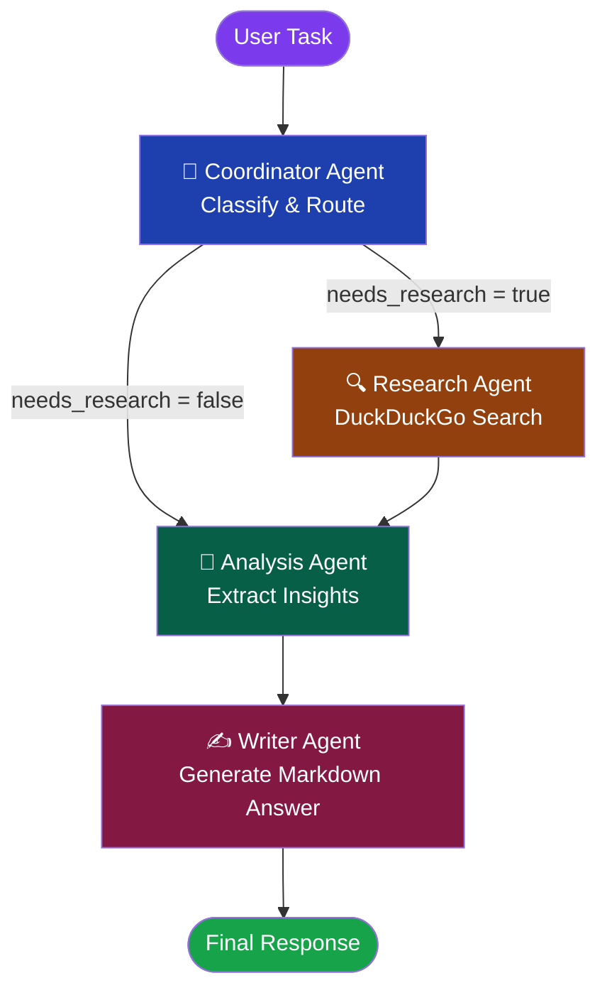

# 🤖 AI Multi-Agent Research and Analysis System

A production-style multi-agent AI system built with **LangGraph**, **Google Gemini**, **DuckDuckGo Search**, and **Streamlit**. The system intelligently routes user tasks through a pipeline of specialised agents — only invoking web research when genuinely required.

---

## ✨ Key Features

- **Smart routing** — Coordinator Agent classifies each task and decides the optimal processing path
- **Real web research** — DuckDuckGo search only when needed; sources are preserved and cited
- **Four distinct agents** — Coordinator, Research, Analysis, Writer with clearly separated responsibilities
- **Streamed live updates** — Agent status cards update in real time as each node completes
- **Conversation memory** — Multi-turn conversation history persisted per session
- **Graceful error handling** — Missing API keys, search failures, and model errors all handled cleanly
- **Portfolio-ready UI** — Dark-themed, responsive Streamlit interface with expandable sections
- **Comprehensive tests** — 25+ unit/integration tests with fully mocked LLM and search calls

---

## 🏗️ Architecture



---

## 🤖 Agent Responsibilities

| Agent | Role | Key Actions |
|-------|------|-------------|
| **Coordinator** | Router & Classifier | Classifies task as `ANALYSIS`, `RESEARCH`, or `RESEARCH_AND_ANALYSIS`; sets `needs_research` flag |
| **Research** | Web Intelligence | Runs DuckDuckGo search, filters irrelevant results, summarises findings, preserves source URLs |
| **Analysis** | Deep Reasoning | Extracts facts, patterns, insights; distinguishes sourced facts from assumptions |
| **Writer** | Final Synthesis | Produces polished Markdown with inline citations, headings, and structured content |

---

## 🔄 Workflow Explanation

1. User submits a task via the Streamlit UI.
2. **Coordinator Agent** classifies the task using Gemini and decides whether web research is needed.
3. If `needs_research = True` → **Research Agent** runs DuckDuckGo search, filters results, and summarises evidence.
4. **Analysis Agent** receives the task + research (if any) and produces structured analytical insights.
5. **Writer Agent** generates the final Markdown response, citing sources where applicable.
6. The UI displays the response with expandable research findings, source URLs, and analysis details.

---

## 🛠️ Technology Stack

| Component | Technology | Version |
|-----------|-----------|---------|
| Language | Python | 3.12 |
| Frontend | Streamlit | 1.64.0 |
| Workflow Orchestration | LangGraph | 1.2.11 |
| LLM Integration | LangChain + LangChain-Google-GenAI | 1.4.2 / 4.4.0 |
| Language Model | Google Gemini | gemini-2.0-flash |
| Web Search | DuckDuckGo Search | 8.1.1 |
| Environment Config | python-dotenv | 1.2.3 |
| Testing | pytest + pytest-mock | 8.3.5 / 3.14.0 |

---

## 📁 Project Structure

```
Multi_Agent/
├── app.py              # Streamlit frontend (UI, streaming, session state)
├── workflow.py         # LangGraph graph: nodes, edges, conditional routing
├── agents.py           # Four agent node functions with prompts & error handling
├── tools.py            # DuckDuckGo search wrappers (filter, extract, format)
├── memory.py           # Conversation history helpers
├── state.py            # Shared AgentState TypedDict schema
├── config.py           # Environment loading, logging, constants
├── requirements.txt    # Pinned dependencies
├── .env.example        # API key template (safe to commit)
├── .gitignore          # Guards .env and Python artefacts
├── README.md           # This file
└── tests/
    ├── __init__.py
    ├── test_agents.py  # Agent unit tests (25 tests, all mocked)
    └── test_workflow.py # Workflow + tools + memory tests
```

---

## ⚙️ Installation (Windows PowerShell)

### 1. Clone / navigate to the project

```powershell
cd "d:\VS Code Work\Agentic_AI\Multi_Agent"
```

### 2. Create and activate a virtual environment

```powershell
python -m venv .venv
.venv\Scripts\Activate.ps1
```

> **Tip:** If you get an execution policy error, run:
> `Set-ExecutionPolicy -ExecutionPolicy RemoteSigned -Scope CurrentUser`

### 3. Install dependencies

```powershell
pip install -r requirements.txt
```

---

## 🔑 API Key Configuration

1. **Get a free Gemini API key** at <https://aistudio.google.com/app/apikey>

2. Copy the example file:
   ```powershell
   Copy-Item .env.example .env
   ```

3. Open `.env` and replace the placeholder:
   ```
   GOOGLE_API_KEY=AIza...your_real_key_here...
   ```

4. **Never commit `.env`** — it is already in `.gitignore`.

---

## 🚀 Running the Application

```powershell
streamlit run app.py
```

The app opens automatically at **http://localhost:8501**

---

## 🧪 Running Tests

```powershell
# All tests (no API key required — everything is mocked)
pytest tests/ -v

# With coverage report
pip install pytest-cov
pytest tests/ -v --cov=. --cov-report=term-missing

# Run a specific test file
pytest tests/test_agents.py -v
pytest tests/test_workflow.py -v
```

---

## 💡 Example Tasks

| Category | Example Task |
|----------|-------------|
| General Knowledge | `What is LangGraph and how does it differ from LangChain?` |
| Live Research | `What are the latest AI model releases in 2025?` |
| Analysis | `Compare Python and Rust for systems programming with examples.` |
| Research + Analysis | `Compare the top cloud providers by pricing and features today.` |
| Technical Explanation | `Explain the CAP theorem with a real-world distributed systems example.` |
| Coding Help | `What are the best practices for securing a REST API?` |

---

## ⚠️ Limitations & Future Improvements

### Current Limitations
- **Rate limits** — Gemini free tier has requests-per-minute limits; large batches may hit 429 errors.
- **Search accuracy** — DuckDuckGo results vary; some queries may return sparse or off-topic results.
- **No persistent storage** — Conversation history resets when the browser tab is closed.
- **Single user** — No multi-user session isolation (Streamlit limitation without auth).

### Future Improvements
- [ ] Add LangGraph checkpointing for persistent cross-session memory
- [ ] Support additional search providers (Tavily, Bing, Google Search API)
- [ ] Add a "deep research" mode with iterative multi-query search
- [ ] Implement token streaming for real-time writer output character-by-character
- [ ] Add user authentication and per-user conversation storage
- [ ] Add an evaluation harness for measuring answer quality
- [ ] Docker containerisation for one-command deployment
- [ ] Async workflow execution for lower latency

---

## 📄 License

MIT — see [LICENSE](LICENSE) for details.
